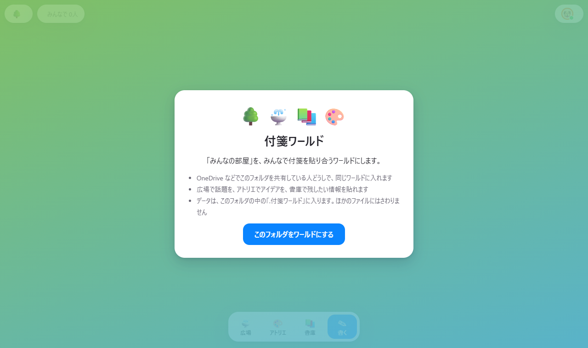
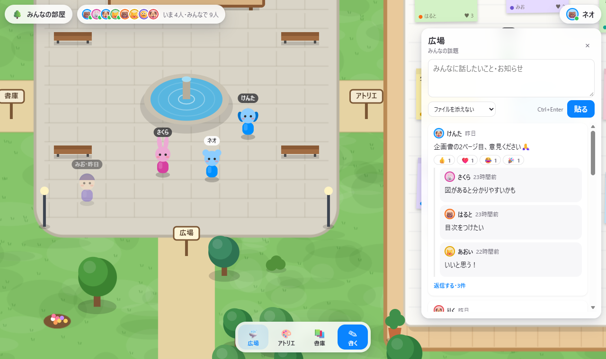
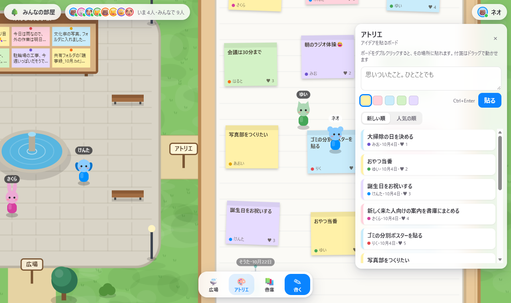
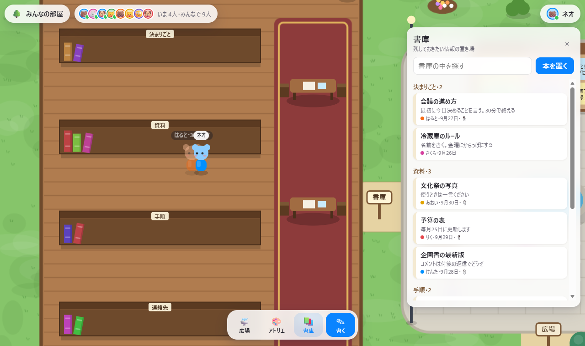

# 付箋ワールド

共有フォルダを、みんなで付箋を貼り合う 2.5D のワールドにします。広場で話題、アトリエでアイデア、書庫で残したい情報です。

サーバーは使いません。通信もしません。OneDrive や NAS などの共有フォルダを、そのまま「場」にします。

[explorer_plus](https://github.com/Neptunity-git/explorer_plus) の MOD です。`neo.sticky-world` 0.1.0。まだ 1.0 より前です。育てている途中なので、動きや保存の形が変わることがあります。





## 3 つの場所

| 場所 | 中身 |
|---|---|
| 広場 | 話題とお知らせ。返信できる |
| アトリエ | 大きなボードに、アイデアの付箋を自由な位置に貼る。誰でもドラッグで動かせる |
| 書庫 | 題名つきの本を、名前の付いた棚に置く。探せる |





- 場所に入ると、右に欄が開きます。狭い画面では、下に開きます。
- 話題と本には、そのフォルダのファイルを添えられます。押すと開きます。
- 景色は、フォルダの名前から決まります。同じフォルダなら、誰が見ても同じ並びです。
- 新着は、数秒おきに確かめます。間隔は、設定で変えられます。

## ほかのファイルは変えません

データは、開いたフォルダの中の `.付箋ワールド` に作ります。

```
.付箋ワールド/
  はじめに.txt               MOD を入れていない人向けの説明
  2026-10/<ID>.json          出来事 1 つにファイル 1 つ
  here/<誰~時刻~x~y>.txt     居場所。1 人 1 ファイルで、名前だけを変える
```

- 書き込みは、「新しく作る」ことと、「自分の居場所のファイルの名前を変える」ことだけです。ほかの人のファイルは書き換えません。だから、同期でぶつかりません。
- 付箋を直す・動かす・消すも、新しい出来事として足されます。消すときは、消した印が付くだけで、ファイルは残ります。
- 直す・消すのは、書いた本人だけです。動かす・リアクションは、誰でもできます。
- 読んだファイルは信じません。形が合わないものは捨てます。

## 入れ方

1. [Releases](https://github.com/Neo-Neptunity/sticky-world/releases) を開き、いちばん新しい版の zip（`neo.sticky-world-版.zip`）をダウンロードします。「Source code」ではなく、自分で付けた zip のほうです。
2. explorer_plus のホームの「MOD」の欄で「＋ MOD を入れる（zip）」を押して、zip を選びます。解凍はしません。
3. 確認の画面の「このビューが使う情報」を読んで、よければ入れます。

## 使う情報

| 使う情報 | 使いみち |
|---|---|
| `entries` | 開いたフォルダの中身を読む |
| `tree` | `.付箋ワールド` の中の、月のフォルダと居場所のフォルダの中身を、一覧する |
| `fileContent` | `.付箋ワールド` の中の、出来事のファイルを読む |
| `createFiles` | `.付箋ワールド` の中に、出来事のファイルと居場所のファイルを作る。最初に許可を聞かれる |

## 設定

新着を確かめる間隔の秒数（3〜60。標準は 5）。

## 作りかた

- [docs/design.md](docs/design.md)：設計書
- [dev/](dev/)：自動の試験と、画面を撮る道具。説明は [dev/README.md](dev/README.md)。そこに書かれたコマンドは、作者の置き場所から流す書き方です。このリポジトリでは、先頭の `sticky-world/` を外して読んでください。

```
node dev/unit.mjs
```

Node.js だけで動きます。`dev/browser.mjs` は Edge か Chrome が要ります。

## ライセンス

[MIT](LICENSE)
